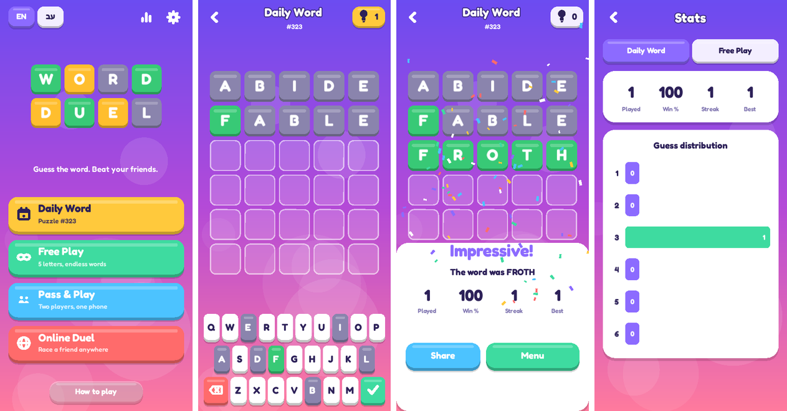

# Word Duel

A playful word-guessing game for Android, in English and Hebrew, built with Kivy.




## Modes

- **Daily Word**: the same 5-letter puzzle for everyone each day. Progress is saved, streaks are tracked, and results can be shared as an emoji grid.
- **Free Play**: endless random words, 4, 5 or 6 letters long.
- **Pass & Play**: one player picks a secret word, the other guesses. Then swap, with a running score.
- **Online Duel**: you and a friend each pick a secret word and take turns guessing. First to crack it wins.

Also: hints (reveal a letter), hard mode, stats with guess distribution, a high-contrast color option, sound and vibration toggles, and full right-to-left support for Hebrew.

## Project layout

```
main.py                  entry point (Buildozer needs it at the root)
wordduel/core/           pure logic, no Kivy: rules, words, game round, storage, i18n, bidi, online
wordduel/ui/             Kivy app, screens, widgets, theme, wordduel.kv
words/                   generated word lists ({lang}_{n}_valid.txt / _answers.txt)
assets/                  fonts (Fredoka, OFL), sounds, icon
tools/                   word-list builder, sound generator, screenshot harness, sources
tests/                   unit tests for the core (pytest)
firestore.rules          suggested Firestore security rules
```

## Running locally

```
pip install kivy==2.3.1 certifi pytest
python main.py           # opens a phone-sized window; your keyboard works too
python -m pytest tests   # core tests, no display needed
```

To regenerate data: `python tools/build_wordlists.py` and `python tools/make_sounds.py`.
For screenshots of every screen: `xvfb-run python tools/screenshots.py OUT_DIR en` (or `he`; add `online` as a third argument for a simulated online duel).

## Building the APK

Run the **Build Android APK** workflow from the GitHub Actions tab. It uses `buildozer.spec` from the repo and uploads the APK as an artifact. Tests run on every push.

## Hebrew text

Kivy draws text left to right only. All strings are stored in normal reading order (`wordduel/core/i18n.py`) and converted at draw time by `wordduel/core/bidi.py`, which also handles wrapping. Never pre-reverse strings.

## Online play (protocol v2)

Games live in Firestore at `games/{6-digit code}` and are reached through the REST API without sign-in. Secret words never leave the phone during play: each player publishes a salted hash of their word, the word's owner scores the opponent's guesses, and both words are revealed and checked against the hashes at the end. The full design is in `wordduel/core/online.py`.

Recommended Firebase setup:
1. Deploy `firestore.rules`.
2. Add a TTL policy on collection `games`, field `expires_at`.

Never commit service-account keys; `.gitignore` blocks the usual file names.
